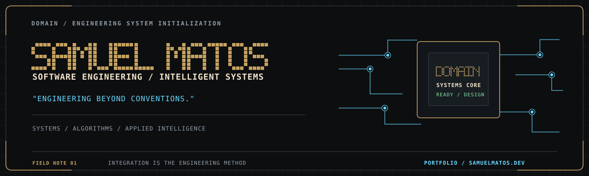
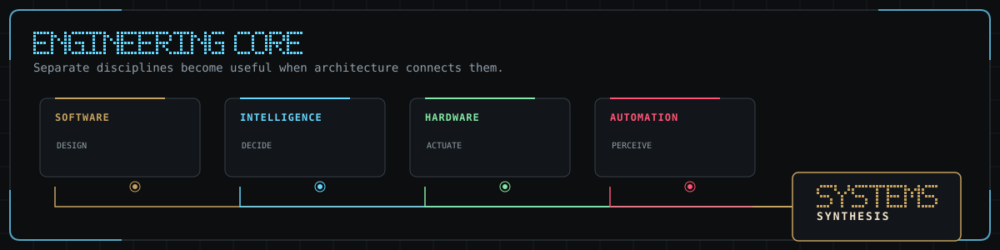
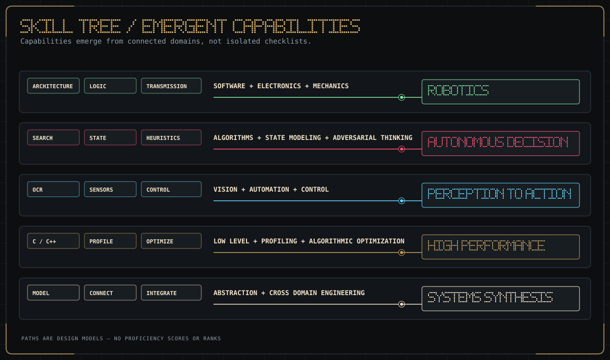
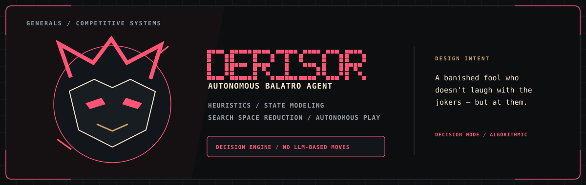
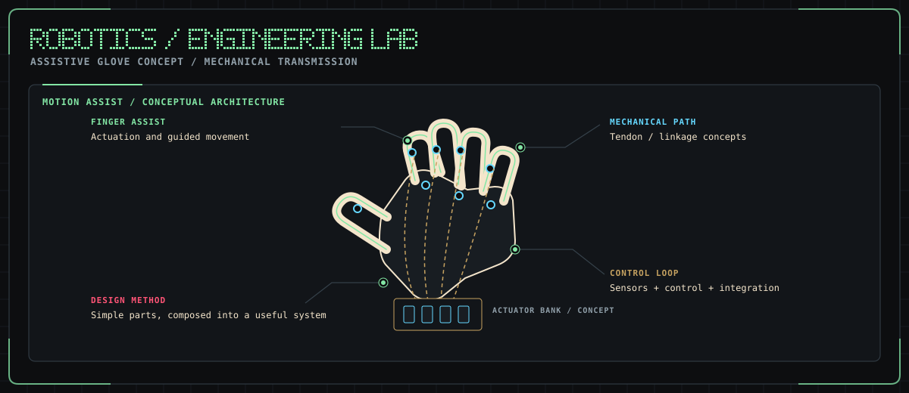
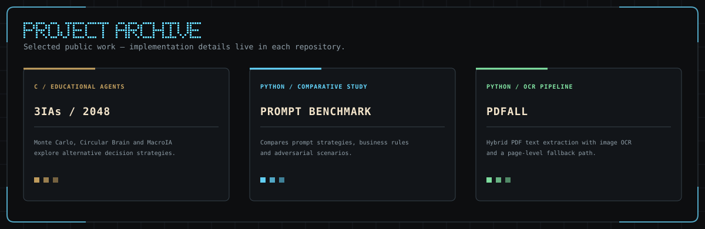
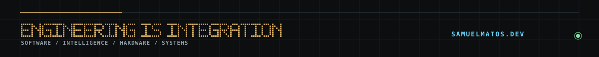

[**samuelmatos.dev ↗**](https://samuelmatos.dev) · [GitHub](https://github.com/SamuelMatos78)

[Português](#pt-br) · [English](#english)

## PT-BR

### Engineering Command Center

Sou estudante de Engenharia de Software e gosto de construir sistemas em que arquitetura, algoritmos e integração entre disciplinas fazem a diferença. Meu foco atravessa software, inteligência aplicada, automação e robótica — com atenção a desempenho, modelagem de estados e soluções que funcionem no mundo real.

### Mapa de competências

A árvore mostra como fundamentos se combinam em capacidades emergentes. Ela representa áreas de interesse e prática, sem atribuir níveis artificiais de proficiência.

- **Tecnologias em foco:** C · C++ · Python · Java · C#.
- **Método:** modelar o problema, conectar mecanismos úteis e validar o sistema sob suas restrições.

### Generals / Competitive Systems

**Derisor** é um agente algorítmico para tomada de decisões em Balatro. A abordagem combina heurísticas, modelagem de estados e redução do espaço de busca para execução autônoma; as jogadas são decididas pelo sistema algorítmico, sem LLM.

[Ver o Derisor no portfólio ↗](https://samuelmatos.dev/#tp=derisor)

### Robotics / Engineering Lab

A luva robótica assistiva é um **conceito em desenvolvimento**: explorar atuadores, mecanismos de transmissão e controle para apoiar o movimento dos dedos. A ilustração representa uma arquitetura conceitual; não indica protótipo concluído, ensaio clínico ou resultado de desempenho.

### Projetos públicos

- [**3IAsParaVencer2048**](https://github.com/SamuelMatos78/3IAsParaVencer2048) — projeto educativo em C que explora três agentes para o jogo 2048: Monte Carlo, Circular Brain e MacroIA.
- [**existential-prompt-benchmark**](https://github.com/SamuelMatos78/existential-prompt-benchmark) — estudo comparativo de estratégias de prompt, proteção de regras de negócio e comportamento em cenários adversariais.
- [**pdfall**](https://github.com/SamuelMatos78/pdfall) — biblioteca Python para extração de PDFs com pipeline híbrida de texto nativo e OCR, incluindo fallback para páginas digitalizadas.

Para acompanhar outros projetos, visite [samuelmatos.dev](https://samuelmatos.dev).

### Experiência / Field Notes

- **Google Accelerate 2026** — participação na equipe campeã.
- **Experiência:** Quero Meus Direitos · Emater.
- **Formação:** Engenharia de Software, em andamento.

## English

### Engineering Command Center

I’m a Software Engineering student who enjoys building systems where architecture, algorithms, and cross-disciplinary integration matter. My interests span software, applied intelligence, automation, and robotics, with a focus on performance, state modeling, and solutions that work under real-world constraints.

### Skill Tree

This tree shows how fundamentals combine into emergent capabilities. It represents areas of interest and practice without assigning arbitrary proficiency levels.

- **Technologies in focus:** C · C++ · Python · Java · C#.
- **Method:** model the problem, connect useful mechanisms, and validate the system against its constraints.

### Generals / Competitive Systems

**Derisor** is an algorithmic agent for decision-making in Balatro. Its approach combines heuristics, state modeling, and search-space reduction for autonomous play; moves are selected by the algorithmic system without an LLM.

[View Derisor on my portfolio ↗](https://samuelmatos.dev/#tp=derisor)

### Robotics / Engineering Lab

The assistive robotic glove is a **concept under development** exploring actuators, mechanical transmission, and control to support finger movement. The illustration shows a conceptual architecture; it does not claim a completed prototype, clinical testing, or measured performance.

### Public Projects

- [**3IAsParaVencer2048**](https://github.com/SamuelMatos78/3IAsParaVencer2048) — an educational C project exploring three agents for 2048: Monte Carlo, Circular Brain, and MacroIA.
- [**existential-prompt-benchmark**](https://github.com/SamuelMatos78/existential-prompt-benchmark) — a comparative study of prompting strategies, business-rule protection, and behavior in adversarial scenarios.
- [**pdfall**](https://github.com/SamuelMatos78/pdfall) — a Python library for PDF extraction using a hybrid native-text and OCR pipeline, including a fallback for scanned pages.

Explore more projects at [samuelmatos.dev](https://samuelmatos.dev).

### Experience / Field Notes

- **Google Accelerate 2026** — member of the winning team.
- **Experience:** Quero Meus Direitos · Emater.
- **Education:** Software Engineering, in progress.

